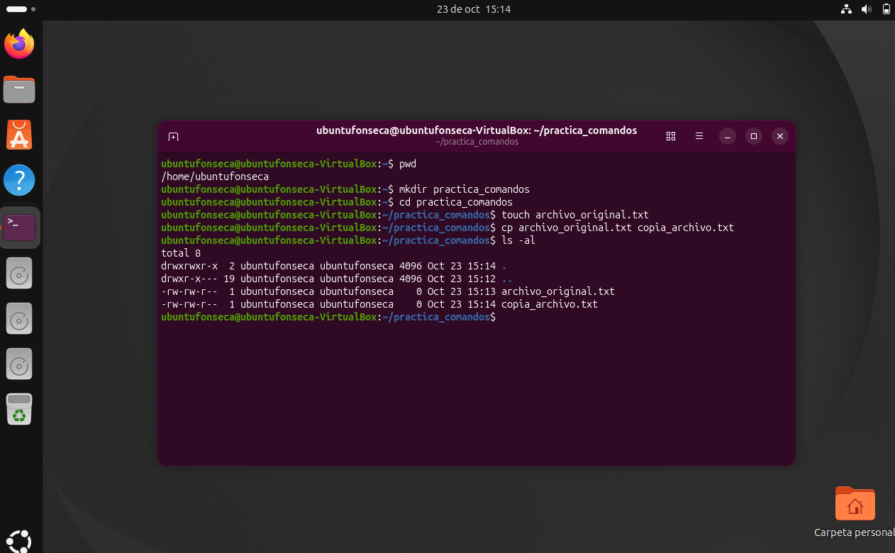
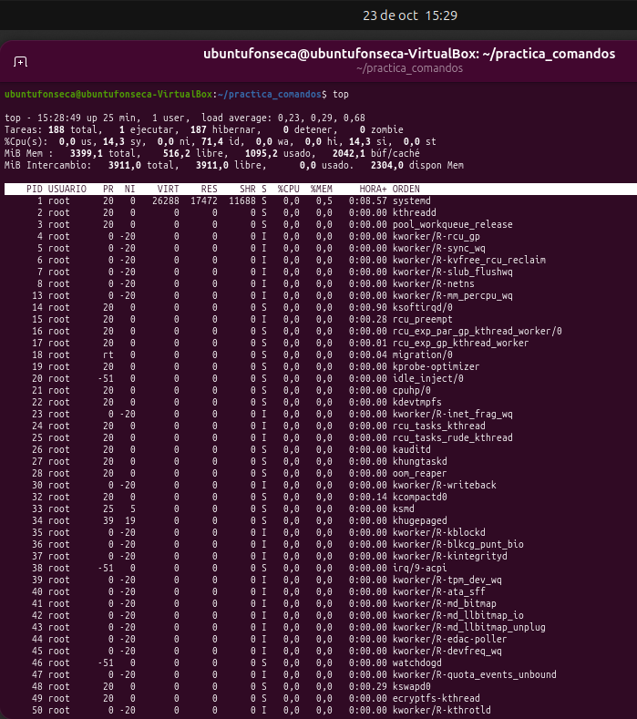
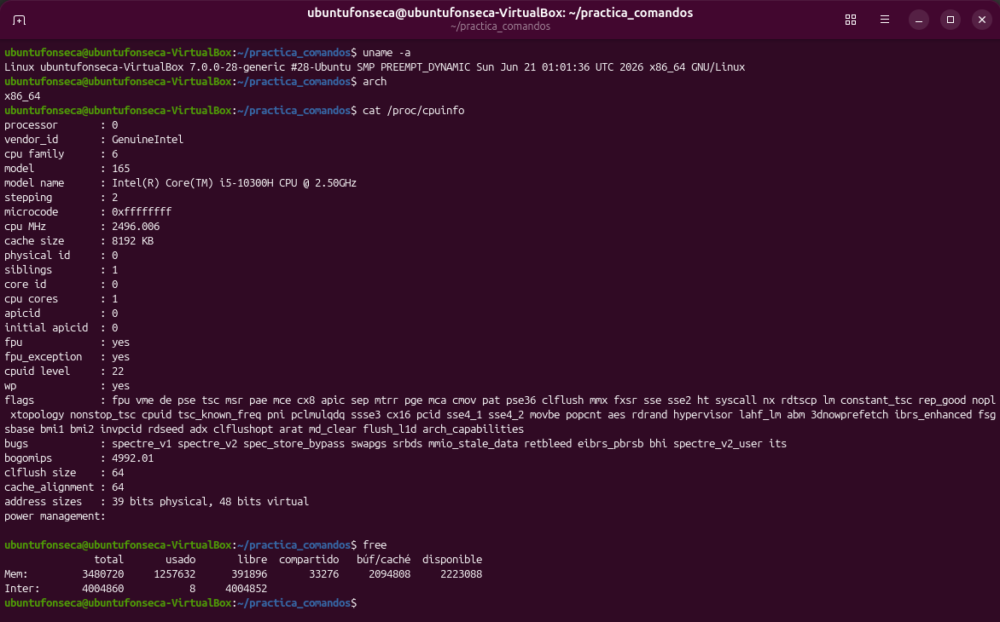
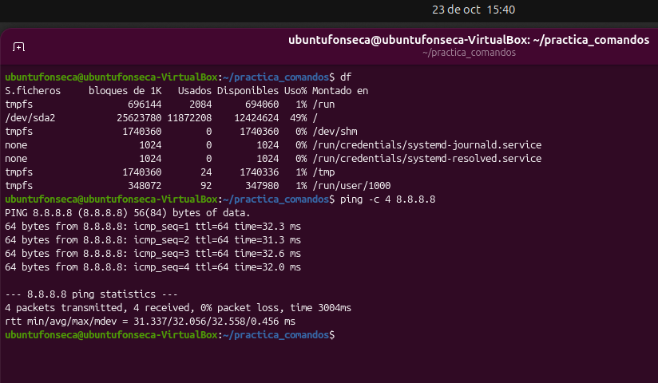

# TP: Comandos Basicos, Procesos y Utilidades en Linux

* **Materia:** Mantenimiento de Software
* **Estudiante:** Thiago Benjamn Fonseca Perez
* **Fecha de Entrega:** 2026
* **Profesor:** Gabriel Artaza

---

## 1. Gestion de Archivos y Directorios

El comando ls muestra los archivos y carpetas que no estan ocultos. En cambio, ls -al tambien muestra los ocultos y da mas detalles, como los permisos, el propietario, el tamaño y la fecha de modificacion.

---

## 2. Monitoreo de Procesos

El comando ps muestra los procesos de la terminal actual en ese momento, mientras que top muestra los procesos del sistema y actualiza la informacion en tiempo real. El comando kill pid sirve para solicitar el cierre de un proceso cuando un programa queda colgado, reemplazando pid por el numero que identifica a ese proceso.

---

## 3. Informacion del Sistema

El comando uname -a muestra informacion del nucleo del sistema, como su nombre, version y fecha de compilacion, ademas de la arquitectura del equipo. El comando free muestra la memoria RAM total, usada y libre, junto con el uso de la memoria de intercambio (swap).

---

## 4. Red y Espacio en Disco

El comando ping sirve para comprobar si hay comunicacion con otro equipo en una red TCP/IP. Para hacerlo, envia paquetes de datos y espera una respuesta del destino.

