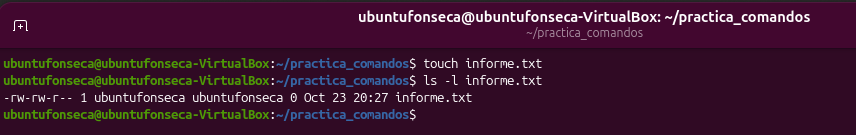
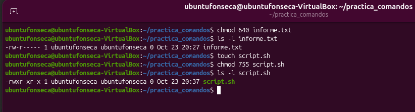
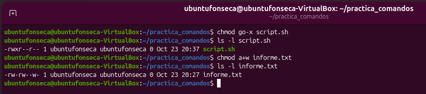
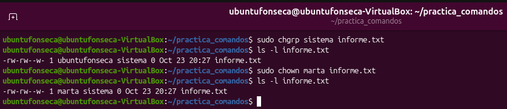
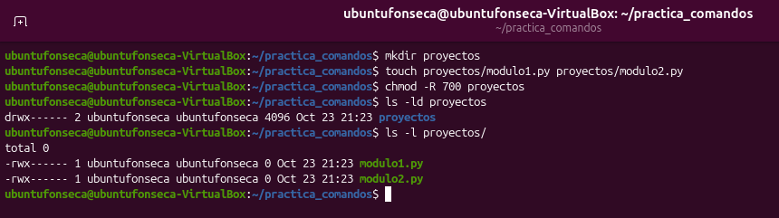

# TP: Permisos de Archivos, Directorios y Propiedad en Linux

* **Materia:** Mantenimiento de Software
* **Estudiante:** Thiago Benjamin Fonseca Perez
* **Fecha de Entrega:** 2026
* **Profesor:** Gabriel Artaza

## 1. Lectura e Interpretación de Permisos (ls -l)

El primer carácter indica el tipo de archivo: `-` representa un archivo común, `d` un directorio y `l` un enlace simbólico.

Los nueve caracteres restantes se dividen en tres grupos: los primeros tres corresponden al propietario, los siguientes tres al grupo y los últimos tres a otros usuarios. En cada grupo, `r` significa lectura, `w` escritura y `x` ejecución. Un guion `-` indica que ese permiso no está habilitado.

En el archivo `informe.txt`, los permisos son `-rw-rw-r--`: el propietario y el grupo pueden leer y modificar el archivo, mientras que otros usuarios solo pueden leerlo. Ninguno tiene permiso de ejecución.

## 2. Permisos en Modo Octal

Para calcular los permisos se suman estos valores: lectura (r) vale 4, escritura (w) vale 2 y ejecución (x) vale 1.

Para obtener 640:
- Propietario: lectura y escritura, 4 + 2 = 6.
- Grupo: solo lectura, 4.
- Otros: sin permisos, 0.

Para obtener 755:
- Propietario: lectura, escritura y ejecución, 4 + 2 + 1 = 7.
- Grupo: lectura y ejecución, 4 + 1 = 5.
- Otros: lectura y ejecución, 4 + 1 = 5.

## 3. Asignación de Permisos en Modo Simbólico

La ventaja del modo simbólico es que permite agregar o quitar un permiso puntual sin cambiar los demás. Por ejemplo, con `chmod go-x script.sh` quité solamente el permiso de ejecución al grupo y a otros. En modo octal tendría que indicar nuevamente los permisos del propietario, del grupo y de otros, aunque solo quisiera cambiar uno.

## 4. Cambio de Propietario y Grupo

Para cambiar el propietario de un archivo hay que usar `sudo` o hacerlo como usuario root, porque se necesitan permisos de administrador. Esto evita que un usuario común pueda poner un archivo a nombre de otro sin autorización, aunque sea dueño de ese archivo.

## 5. Permisos Recursivos en Directorios

El permiso de ejecución (`x`) en un directorio permite entrar a esa carpeta y acceder a sus archivos, siempre que sus permisos lo permitan. Si se le quita, el usuario no puede entrar con `cd` ni acceder a los archivos que contiene. Si todavía tiene permiso de lectura, puede ver los nombres de los archivos, pero no abrirlos.