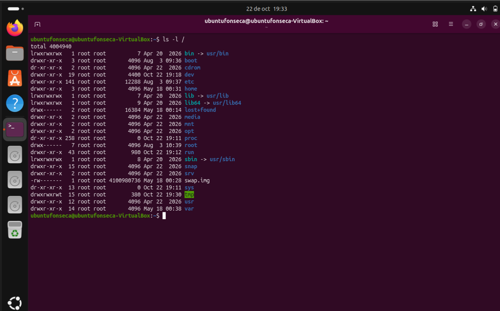
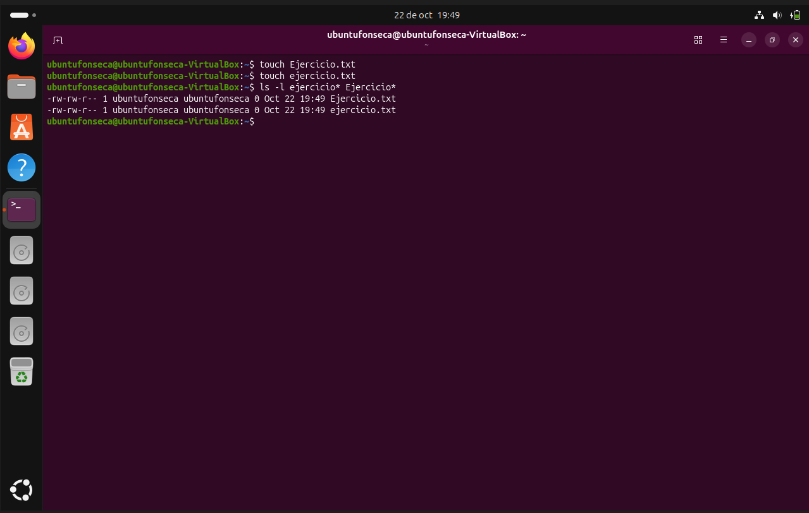
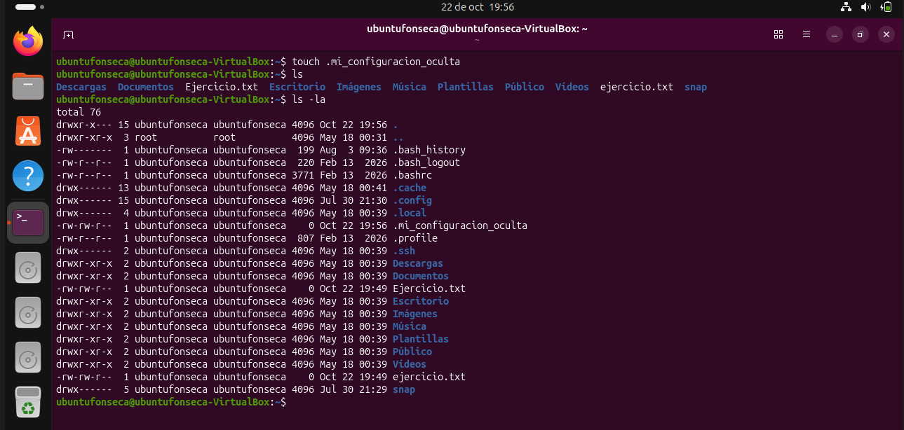
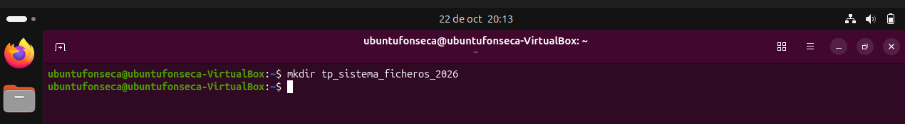
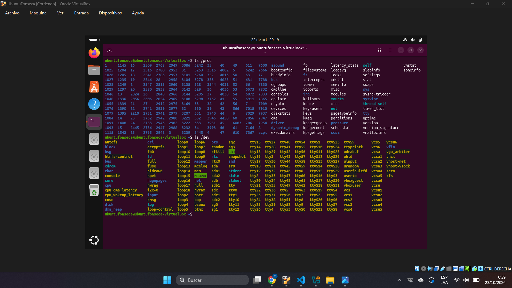

# Trabajo Practico Laboratorio: Exploracion del Sistema de Archivos en Linux

* **Materia:** Mantenimiento de Software
* **Estudiante:** Thiago Benjamin Fonseca Perez
* **Fecha de Entrega:** 2026
* **Profesor:** Gabriel Artaza

---

## 1. Estructura del Arbol de Directorios

- `/etc`: Contiene los archivos de configuracion de la mayoria de los programas.
- `/home`: Contiene los archivos personales de los usuarios.
- `/dev`: Contiene archivos que representan partes del hardware, como discos duros y memoria.
- `/var`: Contiene datos como registros de actividad de programas, bases de datos, contenidos del servidor web y copias de seguridad.

---

## 2. Sensibilidad a Mayusculas y Minusculas

En Linux los nombres de archivos distinguen entre mayusculas y minusculas. Por eso Ejercicio.txt y ejercicio.txt son nombres distintos y pueden estar en la misma carpeta. En Windows, por defecto, ambos se consideran el mismo nombre.

---

## 3. Visualizacion y Gestion de Archivos Ocultos

Los archivos ocultos sirven para guardar configuraciones y otros datos que utilizan los programas sin llenar de archivos el listado habitual de las carpetas. En Linux, sus nombres comienzan con un punto. Por eso, el archivo creado no aparece con ls, pero si con ls -la.

---

## 4. Buenas Practicas en Nombres de Archivos

El nombre tp_sistema_ficheros_2026 cumple con las recomendaciones de la guia porque utiliza letras, numeros y guiones bajos, sin espacios ni caracteres especiales. En cambio, TP Sistema de Ficheros (Año 2026)!.doc contiene espacios, la letra ñ, parentesis y un signo de exclamacion, que la guia recomienda evitar.

---

## 5. Exploracion de Dispositivos y Procesos

El directorio /proc contiene informacion temporal sobre los procesos del sistema, es decir, los programas y tareas que se estan ejecutando.