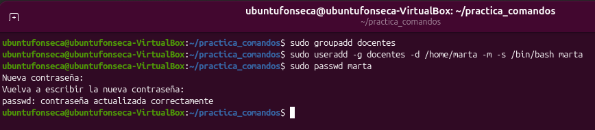
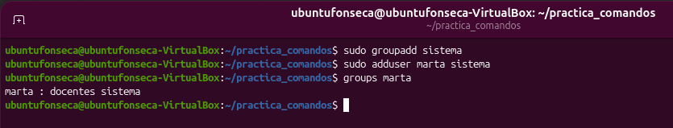
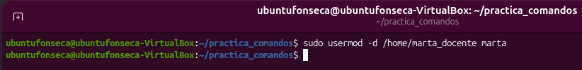
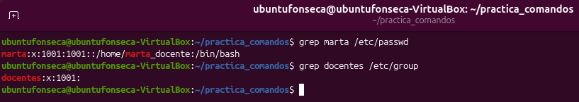
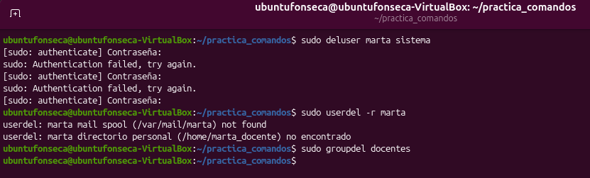

# TP: Administración de Usuarios y Grupos en Linux

* **Materia:** Mantenimiento de Software
* **Estudiante:** Thiago Benjamín Fonseca Perez
* **Fecha de Entrega:** 2026
* **Profesor:** Gabriel Artaza
---

## 1. Creación de Grupos y Usuarios

El parámetro -m de useradd crea la carpeta personal del usuario si no existe. Si se omite, la carpeta no se crea y habría que crearla manualmente.

---

## 2. Gestión de Grupos Secundarios

Para quitar a un usuario de un grupo secundario se utiliza deluser, seguido del nombre del usuario y del grupo. En este caso, el comando sería sudo deluser marta sistema.

---

## 3. Modificación de Usuarios

El comando useradd sirve para crear un usuario nuevo, mientras que usermod permite modificar los datos de un usuario que ya existe, como su directorio personal, su shell o los grupos a los que pertenece.

---

## 4. Ficheros de Configuración

El fichero /etc/passwd guarda información de los usuarios, como su nombre, directorio personal y shell. El fichero /etc/group guarda información sobre los grupos de usuarios. Por último, /etc/shadow almacena las contraseñas protegidas y la configuración de su validez y cambio.

---

## 5. Eliminación de Usuarios y Grupos

La opción -r de userdel elimina la carpeta personal del usuario junto con su cuenta. Para que groupdel permita borrar un grupo, ningún usuario debe tener ese grupo como principal.